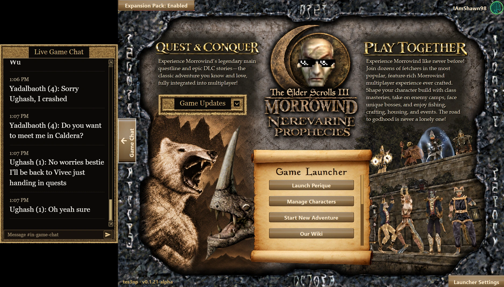

# tes3np

A robust game launcher for the Morrowind private server [Nerevarine Prophecies](https://wiki.nerevarineprophecies.com/Main_Page).

## Features

- **Character Management** — Register up to ten existing characters and log in up to four at a time. Mark any character as your favorite for quick logins right from the launcher’s startup page. Each species has its own loading icon, and you can add a custom profile picture for each character.
- **Auto Login** — Characters you register in the launcher can be logged in automatically from the **Manage Characters** page. The first character you add automatically becomes your favorite, and you can switch favorites at any time. Your favorite character appears on the launcher’s startup page for easy access.
- **Data Backups** — Your launcher data can be exported so you can reinstall or relocate at any time.
- **Expansion Pack Support** — Enable or disable expansion packs any time. If an expansion pack isn't installed, first time enabling it will ask if you want to download and install it automatically. If a new expansion pack releases, it will update to the latest version for you.
- **Macro Integration** — Upload your favorite macro scripts for things like fishing and training. Turn them on and off or tailor them to fit the launcher. Everything you use in one safe, backed-up environment.
- **Custom Game Clients** — Have a custom version of tes3mp.exe and don't want to give it up? Simply go to **Launcher Settings → Game Client Settings** and set your custom client as your default and change back or update it any time you need.
- **Discord Integration** — If you log into Discord via the launcher you will gain access to auto downloading expansion packs, game chat integration with the launcher, and even offline happy hour alerts.
- **And More** — My goal with tes3np is to create a companion app to the game itself that bridges the community platforms (Discord, Wiki, and in-game) seamlessly. The installation process is simple, just follow the instructions below.

## Download

Open the [**TES3NP website**](https://iamshawn98.github.io/tes3np/) and click **Download for Windows**.

## Requirements

- Windows 10 or 11, 64-bit.
- [Morrowind Game of the Year Edition](https://en.uesp.net/wiki/Morrowind:Morrowind) with Tribunal and Bloodmoon.

If the chat window doesn't function after logging into Discord, you might need to download [Microsoft WebView2 Runtime](https://developer.microsoft.com/en-us/microsoft-edge/webview2/#download-section).

The Windows ZIP includes TES3MP 0.8.1 and AutoHotkey v2.

## Install

1. Extract the entire Windows ZIP into its own folder.
2. Run `tes3np.exe`. If asked, choose your Morrowind GOTY folder.
3. Open **Manage Characters** to save a character, or choose **Start New Adventure** to log in manually.

## Update

Click the version number in the bottom left corner to check for updates. You can review the release notes before downloading and installing. Keep your `%APPDATA%\tes3np` folder so your characters and preferences carry over. If all you care about is your character list, simply click **Export Data** in **Manage Characters** and that should be good enough.

## Bug Reporting

Open **Launcher Settings → Launcher Data → Report A Bug**. Describe what you were doing and what happened. Add screenshots if they help show the issue, then click **Send Report**. The launcher automatically attaches your launcher logs to help troubleshooting. The logs only contain diagnostic data, no personal information!
