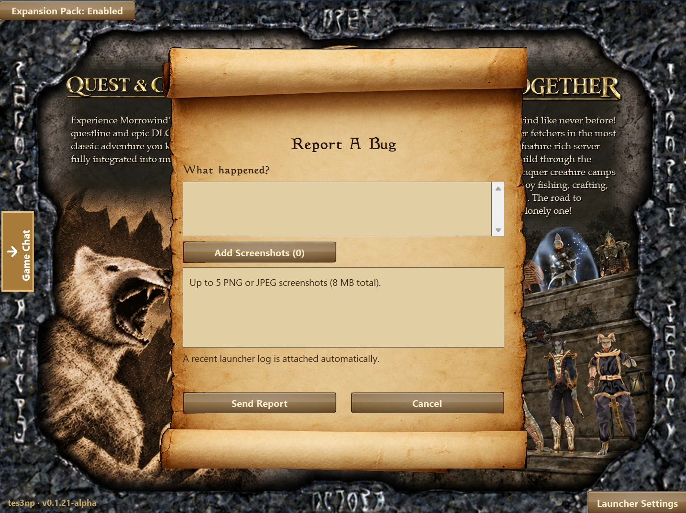

# tes3np

A robust game launcher for the Morrowind private server [Nerevarine Prophecies](https://wiki.nerevarineprophecies.com/Main_Page).

## Features

- **Character Management and Auto Login** — Save up to ten characters, log in up to four at once, and set a favorite for quick login.
- **Character Portraits** — Use the built-in race icons or add a custom portrait for a character's login screen.
- **Data Backups** — Export saved character details and login delays to move them to another PC.
- **Expansion Pack Support** — Install or update the official pack through Discord, or import a ZIP or extracted folder.
- **Macro Integration** — Run AutoHotkey scripts, ZIP macro packages, or linked Windows apps from **Manage Characters**.
- **Custom Game Clients** — Use the included TES3MP client or configure your own executable and dependencies.
- **Game Chat and Happy Hour** — Read live Discord chat and see active Happy Hour countdowns from new or saved announcements.

## Download

The recommended way to download TES3NP is to open the [**TES3NP website**](https://iamshawn98.github.io/tes3np/) and click **Download for Windows**.

You can also download the Windows ZIP from [**GitHub Releases**](https://github.com/IAmShawn98/tes3np/releases).

## Quick Start

Requires **Windows 10 or 11 (64-bit)** and [**Morrowind GOTY**](https://en.uesp.net/wiki/Morrowind:Morrowind) with Tribunal and Bloodmoon. The ZIP includes TES3MP 0.8.1 and AutoHotkey v2.

1. Extract the entire Windows ZIP into its own folder.
2. Run `tes3np.exe`. If prompted, select your Morrowind GOTY folder.
3. Open **Manage Characters** to save a character, or click **Start New Adventure** to log in manually.

If Game Chat isn’t working, check whether [Microsoft WebView2 Runtime](https://developer.microsoft.com/en-us/microsoft-edge/webview2/#download-section) is installed. It comes with Windows 11 and is already installed on most Windows 10 PCs.

See [player guide](docs/USER-GUIDE.md) for a more in-depth user guide.

## Update

Click the version number in the bottom-left corner to review release notes and check for updates. Keep `%APPDATA%\tes3np` to preserve your characters and preferences.

## Bug Reporting

Open **Launcher Settings → Launcher Data → Report A Bug** to send a description, diagnostic logs, and optional screenshots.

## Latest Update

### v0.1.21-alpha — unreleased

Changes since the last public release, v0.1.20-alpha.

#### New Features

- **Game Chat:** Read live Nerevarine Prophecies Discord messages alongside the launcher.
- **Bug reporting:** Send a report from **Launcher Data** with diagnostic logs and optional screenshots.
- **Bundled TES3MP:** The Windows ZIP includes the TES3MP 0.8.1 client and its dependencies.
- **Happy Hour notifications:** See an active Happy Hour and its remaining time on the launcher.
- **Plugin mismatch recovery:** If your plugins don't match the server's, the launcher helps you download the Expansion Pack and troubleshoot the problem.
- **TES3MP Setup:** Choose a custom TES3MP executable without replacing the bundled client.
- **Login Progress:** See your character's login steps in a dedicated progress window.
- **Race:** Select your character's race in **Manage Characters** to show its matching icon during login.
- **Original Character:** Choose **Original Character** in the **Race** selector to use a custom portrait.

#### Improvements

- **Expansion Pack updates:** TES3NP checks for the official pack before character login or re-enabling an installed pack. The update prompt shows the installed version when it can identify it, shows the available version, and lets you install from Discord or select a local package.
- **Expansion Pack toggle:** See progress while enabling the pack and a single confirmation when it is enabled or disabled.
- **Launcher update channels:** Alpha, beta, and live builds check their own feeds and show when a hotfix is available.
- **Launcher Interface:** Improved window scaling, menu positioning, and dialog appearances for a more consistent experience.
- **Upload Expansion:** Install the Expansion Pack from a downloaded ZIP file or an extracted folder.
- **Diagnostics:** Improved diagnostics for mismatches and error handling.
- **Favorite character:** Your first added character is now automatically selected as your favorite.

#### Bug Fixes

- **Character reconnect** — Edit a character to enable automatic reconnect after a crash. Closing the game normally leaves it closed.
- **Game Chat** — Fixed a blank chat panel after first-time sign-in that could require restarting the launcher. The loading message and scrollbar now appear during the transition into Game Chat.
- **Discord sign-in** — Expansion Pack checks open the dedicated sign-in window when needed and resume after you sign in. Sign-in requests made while Discord is initializing are also handled.
- **Manage Characters** — Fixed visible flashing when editing or deleting characters and reduced the delay when closing the page.
- **Manage Macros** — Fixed a brief redraw glitch when saving a macro name.
- **Morrowind setup** — Fixed launch attempts that could proceed with missing game files. The launcher now opens the Morrowind folder picker.
- **Expansion Pack imports** — Fixed imports that could fail when Windows briefly locked a file and removed a size limit that rejected the official Expansion Pack ZIP.
- **Character backups** — Fixed an import error caused by the launcher trying to update a removed TES3MP executable field while restoring game client settings.
- **Desktop shortcut prompt** — Fixed cases where the prompt could reappear after a choice had already been saved.
- **Launcher updates** — Fixed a Windows PowerShell encoding issue that could prevent the updated launcher from confirming startup.
- **AppData cleanup** — The launcher now clears stale partial downloads, temporary files, and obsolete launcher caches on startup.
- **Diagnostic privacy** — Removed sensitive details such as local file paths and private URLs from diagnostic logs and copied reports.

#### Removed Features

- **Scheduled Events:** I decided to remove Scheduled Events because it doesn't align with my current plans for the launcher. Pieces of this feature will end up in future versions in some capacity.
